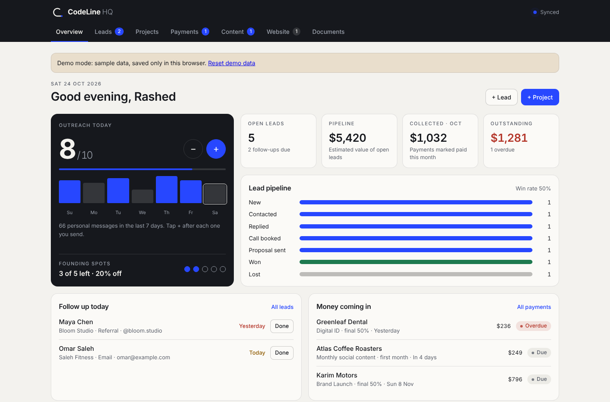
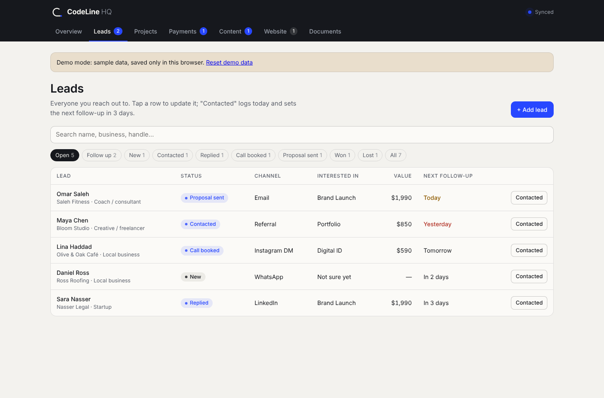
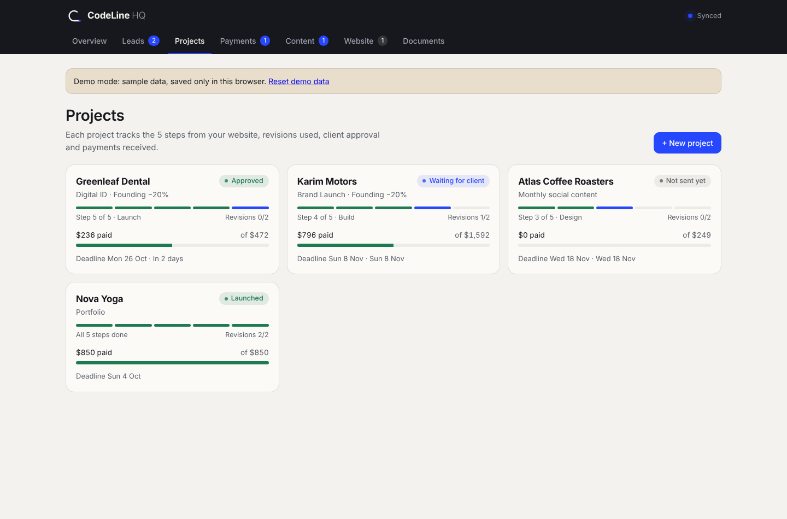
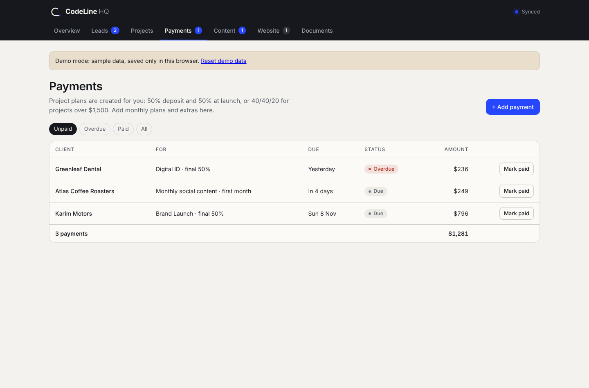
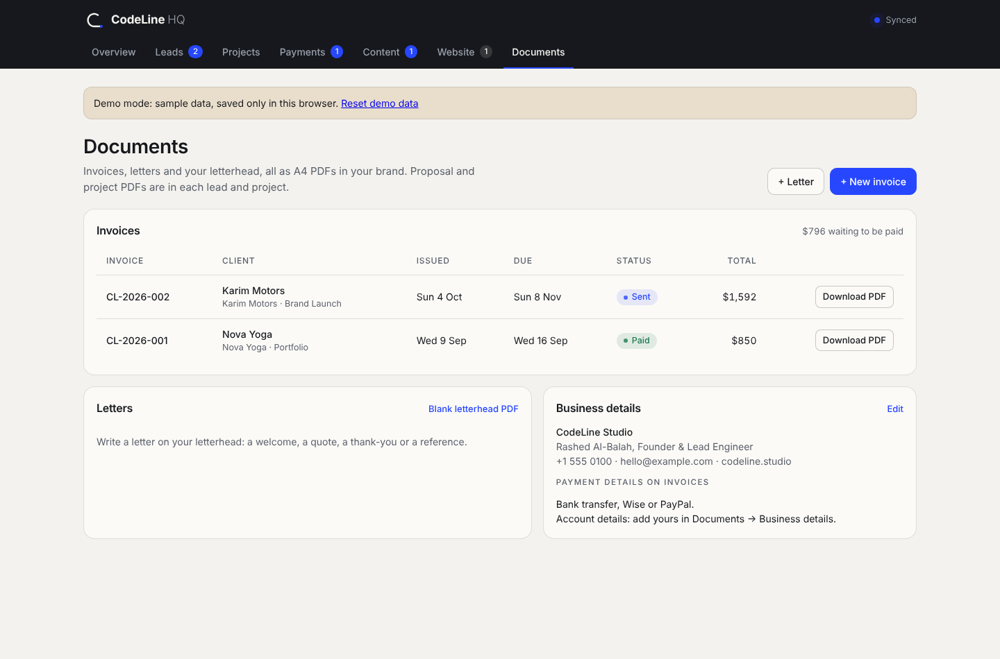
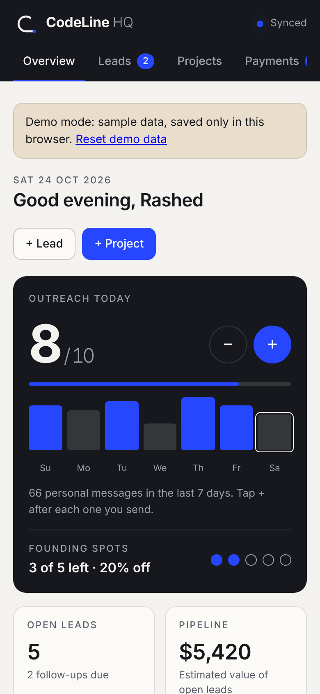

# CodeLine HQ: Studio Management Dashboard

An all-in-one business dashboard that runs **CodeLine Studio**: lead pipeline, projects, payment plans, a content calendar, website CMS, and branded PDF invoices and proposals, all in one fast, dependency-free web app.

**Live demo:** https://mralbalah.github.io/codeline-hq/ (sample data, saved only in your browser)



## Why I built it

Running a one-person studio meant juggling spreadsheets, notes apps and invoice templates. CodeLine HQ replaces them with one screen that answers four daily questions: *Who do I follow up with today? What's due? What's been paid? What's posting this week?*

## Features

| Area | What it does |
|---|---|
| **Overview** | Daily outreach counter with a 7-day chart, pipeline value, money collected and outstanding, follow-ups due today, upcoming payments |
| **Leads (CRM)** | 7-stage pipeline (New → Won/Lost), channels, client types, follow-up reminders, search and filters, a one-click **proposal PDF** |
| **Projects** | 5-step delivery tracker (Discovery → Launch), client approval status, revision rounds, founding-client discount logic |
| **Payments** | **Automatic payment plans** when a project is created (50/50, or 40/40/20 above $1,500), overdue detection, payment methods |
| **Content** | Social media calendar grouped by week: format, hook, caption, hashtags, status |
| **Website CMS** | Edits the live studio website's text, photos, packages and newsletter through the **Google Sheets & Drive APIs** |
| **Documents** | Numbered invoices (CL-YYYY-NNN), discounts and tax, letters on letterhead, all exported as **A4 PDFs** in the studio brand |
| **Sync** | Realtime updates through `onSnapshot` listeners, so the dashboard, phone and desktop app all show the same data |

| Leads | Projects |
|---|---|
|  |  |

| Payments | Documents |
|---|---|
|  |  |

<p align="center"></p>

## Tech & architecture

- **Vanilla JavaScript (ES5), HTML5, CSS3** in a single file with no framework and no build step. A tiny `h()` helper builds the DOM, and render calls are batched with `requestAnimationFrame`.
- **Realtime document database** with a Firestore-style API (`collection`, `doc`, `add`, `set`, `update`, `delete`, `onSnapshot`, `orderBy`, `limit`).
- **Google Sheets & Google Drive APIs** for the website CMS: the [CodeLine Studio website](https://github.com/mralbalah/codeline-studio-website) reads its content from the same sheet.
- **html2pdf.js** (jsPDF + html2canvas), loaded only when a PDF is first exported.
- **Design system:** CSS custom properties, automatic **light/dark mode**, responsive mobile-first layout, and accessible focus states and labels.

### Demo mode

In production the app runs inside a host that provides the cloud database and API connectors. For this public repo, [`demo/demo-runtime.js`](demo/demo-runtime.js) adds a small **localStorage-backed database with the same API** and fills it with fictional sample data. The app code itself runs unchanged.

## Run locally

```bash
npx serve .
# or
python -m http.server 8080
```

Open `http://localhost:8080`. Click **Reset demo data** in the banner to start fresh.

## Project structure

```
├── index.html            # The whole app: styles, markup and logic
├── demo/
│   └── demo-runtime.js   # localStorage database + sample data for the public demo
└── docs/                 # Screenshots
```

## Author

**Rashed Al-Balah**: Full-Stack Developer & Founder, CodeLine Studio
[GitHub](https://github.com/mralbalah) · mralbalah@gmail.com

---

© 2026 CodeLine Studio. Shared as a portfolio piece. All client names and figures in the demo are fictional.
